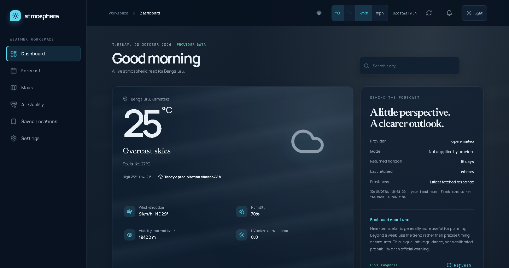
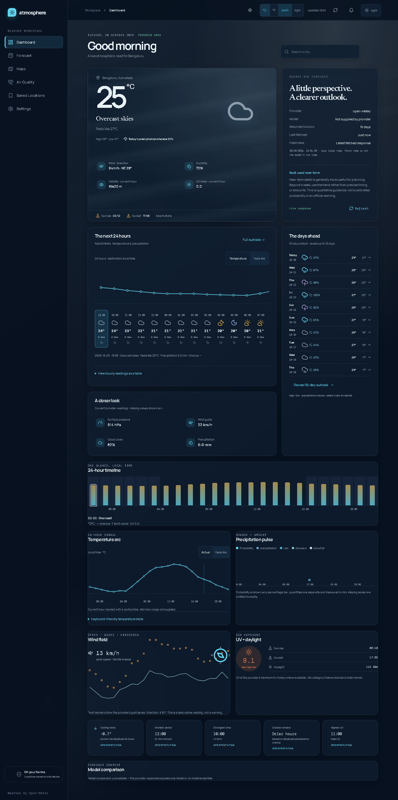
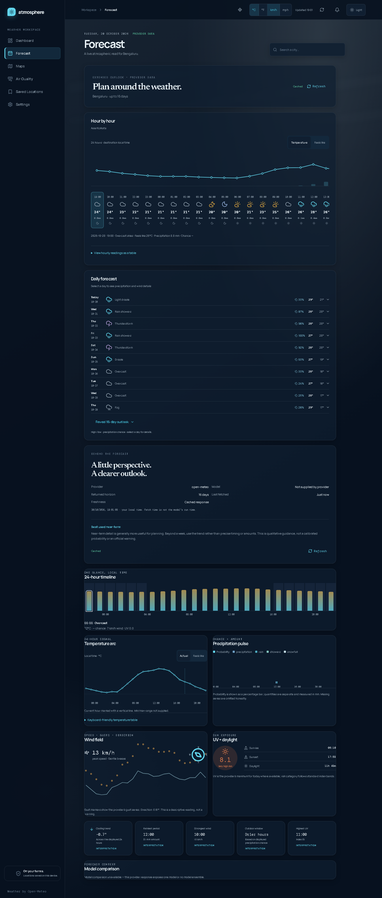
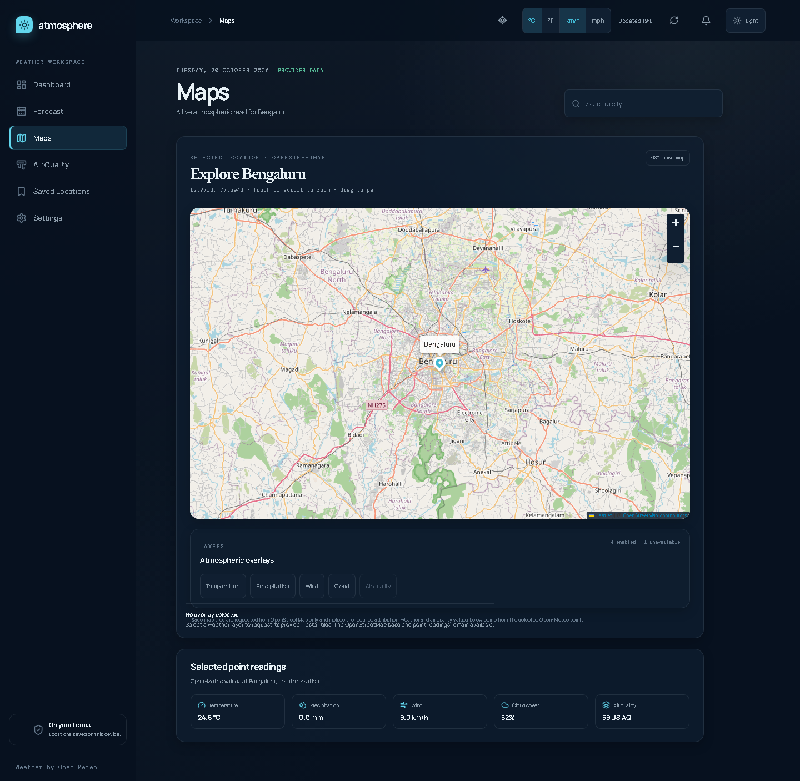
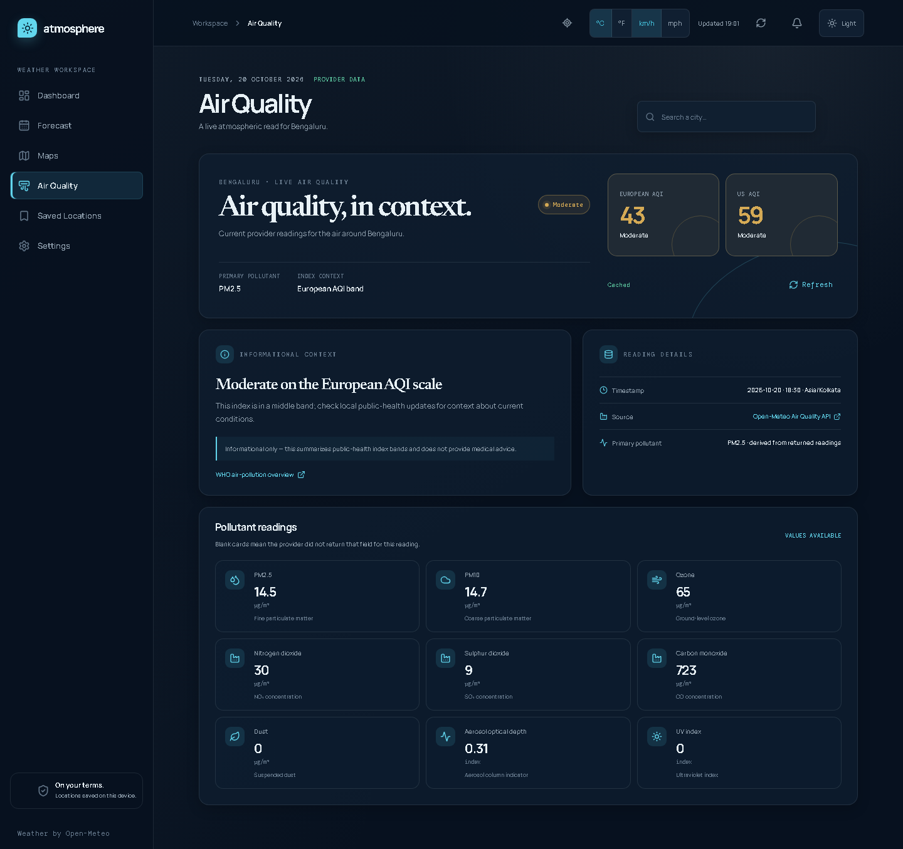
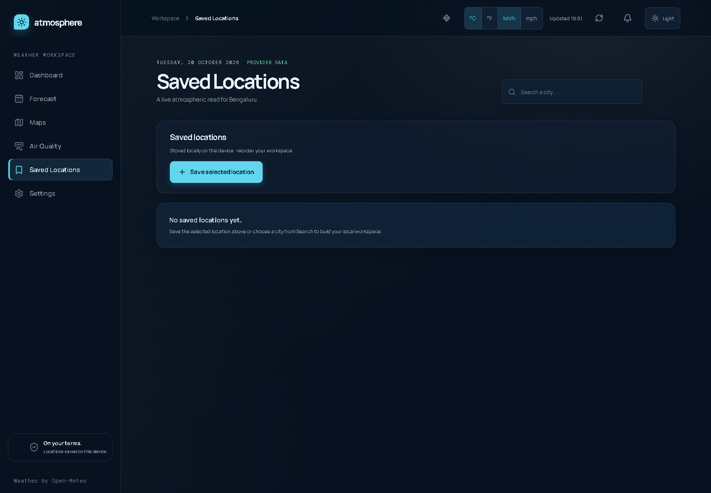
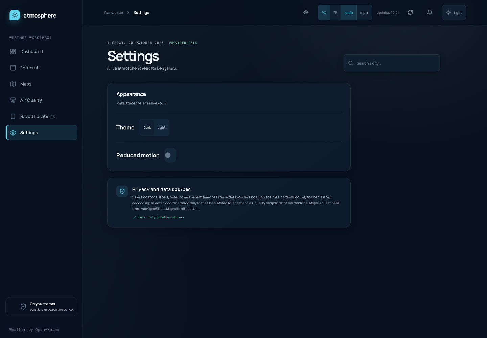

# Atmosphere — Weather with feeling

<p align="center">
  
</p>

<p align="center">
  <strong>A calm, transparent weather workspace for planning the next hours and days.</strong><br />
  Live forecasts, air-quality context, interactive maps, saved places, and resilient provider boundaries — presented without dashboard clutter.
</p>

<p align="center">
  <a href="https://atmosphere-weather-amber.vercel.app"></a>
  <a href="https://github.com/Roastee/Atmosphere---Weather-With-feeling/actions/workflows/ci.yml"></a>
</p>

<p align="center">
  <a href="https://react.dev/"></a>
  <a href="https://www.typescriptlang.org/"></a>
  <a href="https://vite.dev/"></a>
  <a href="https://leafletjs.com/"></a>
</p>

> **Try it now:** [atmosphere-weather-amber.vercel.app](https://atmosphere-weather-amber.vercel.app)

Atmosphere is a browser-first React application that makes weather information easier to read, easier to question, and safer to operate. It labels provider freshness, keeps missing values honest, stores personal preferences locally, and contains optional map-provider failures instead of allowing them to take down the workspace.

## Product tour

Watch the short [Atmosphere walkthrough video](docs/demo/atmosphere-walkthrough.webm), or browse the captured product surfaces below. The screenshots were generated from the live Vercel deployment.

<table>
  <tr>
    <td width="50%"><a href="docs/screenshots/dashboard.png"></a></td>
    <td width="50%"><a href="docs/screenshots/forecast.png"></a></td>
  </tr>
  <tr>
    <td align="center"><sub>Dashboard · current conditions and near-term planning</sub></td>
    <td align="center"><sub>Forecast · extended outlook and accessible detail</sub></td>
  </tr>
  <tr>
    <td width="50%"><a href="docs/screenshots/maps.png"></a></td>
    <td width="50%"><a href="docs/screenshots/air-quality.png"></a></td>
  </tr>
  <tr>
    <td align="center"><sub>Maps · OpenStreetMap base with optional weather overlays</sub></td>
    <td align="center"><sub>Air quality · index context and pollutant provenance</sub></td>
  </tr>
  <tr>
    <td width="50%"><a href="docs/screenshots/saved-locations.png"></a></td>
    <td width="50%"><a href="docs/screenshots/settings.png"></a></td>
  </tr>
  <tr>
    <td align="center"><sub>Saved locations · local-first place management</sub></td>
    <td align="center"><sub>Settings · units, theme, and reduced motion</sub></td>
  </tr>
</table>

## What makes it different

- **Readable by default:** a calm visual hierarchy turns a dense forecast into a useful planning surface.
- **Transparent data:** provider, model, timestamp, freshness, cache state, and unavailable values are visible rather than implied.
- **Resilient by design:** retries, timeouts, stale-cache fallback, request deduplication, and isolated map overlays keep the workspace useful when a provider is not.
- **Local-first preferences:** saved places, labels, units, theme, and reduced-motion preferences stay in the browser.
- **Accessible interaction:** keyboard-operable navigation, semantic regions, announced status changes, and table alternatives accompany the visual views.

## Product and features

- **Dashboard:** current conditions, a 24-hour outlook, a 10-day summary, weather details, and optional analytical views.
- **Extended forecast:** reveal the provider's returned horizon (up to 16 days), expand a day for precipitation and wind details, and inspect an accessible hourly table.
- **Air quality:** current European and US AQI context, returned pollutant values, timestamps, provider source, and an informational public-health explanation.
- **Location workflows:** search Open-Meteo's geocoder, use the browser's current location after an explicit confirmation, save locations, rename them, choose a default, reorder them, compare saved readings, and revisit recent searches.
- **Maps:** an OpenStreetMap base map centered on the selected location, with required attribution. The UI supports one-at-a-time weather raster overlays through the same-origin `/api/map-tile` route; the air-quality raster layer stays disabled until a provider is selected.
- **Personalization:** Celsius/Fahrenheit and km/h/mph controls, dark/light theme, and reduced-motion preference.
- **Resilience and transparency:** schema-validated provider responses, bounded retries, timeouts, request deduplication, cache freshness labels, stale-cache fallback, explicit missing values, provider/model metadata, and retry controls.
- **Accessible interaction:** semantic regions, keyboard-operable navigation and forecast details, status announcements, reduced-motion support, and a table alternative for chart-like views.

## Stack

- React and React DOM for the application UI.
- TypeScript for application and configuration code.
- Vite for development, production bundling, and local preview.
- Leaflet for the OpenStreetMap map surface.
- Zod for runtime validation of external provider responses.
- Vitest and Testing Library for unit/component checks.
- Playwright for deterministic browser checks against the built preview by default.
- Lucide React for interface icons.

The provider boundary is in `src/lib/api/`; UI components consume typed results rather than calling `fetch` directly. Map layer metadata is in `src/lib/mapLayers.ts`, map types are in `src/types/map.ts`, and the framework-neutral authenticated tile proxy core is in `src/server/tileProxy.ts`. The existing mock data in `src/data/mockWeather.ts` remains useful for component-level development, while the dashboard, forecast, location search, and air-quality views use the Open-Meteo provider at runtime.

For the request flow, reliability model, and privacy boundaries, see [`docs/architecture.md`](docs/architecture.md).

## Providers and endpoints

The base application uses public HTTPS endpoints and does not require a client-side API key:

| Capability | Endpoint | Request purpose |
| --- | --- | --- |
| Location search | `https://geocoding-api.open-meteo.com/v1/search` | Debounced city search with `name`, `count`, `language`, and `format` query parameters. |
| Weather forecast | `https://api.open-meteo.com/v1/forecast` | Current, hourly, and daily weather for selected coordinates, timezone, forecast range, and display units. |
| Air quality | `https://air-quality-api.open-meteo.com/v1/air-quality` | Current AQI and pollutant fields for selected coordinates and timezone. |
| Map base layer | OpenStreetMap tiles through Leaflet | Base geography only; the map displays the provider attribution supplied by Leaflet. |
| Weather raster overlays | Vercel `/api/map-tile` → OpenWeatherMap tiles | Temperature, precipitation, wind, and cloud layer requests; requires the server-only `OPENWEATHER_API_KEY`. |

The weather client requests the fields used by the dashboard, including temperature, apparent temperature, precipitation, weather code, cloud cover, pressure, wind, visibility, UV, and daily high/low and precipitation fields. The air-quality client treats pollutant fields as optional because a provider response can omit a field for a location or model run.

Open-Meteo responses are validated with Zod before they reach the UI. Provider metadata includes the provider name, source endpoint, returned model when supplied, fetch time, cache state, stale state, and any fallback warning.

## Environment variables and secrets

No `.env` file or application environment variable is required for local development, testing, or the base deployment. The current Open-Meteo clients intentionally use their public endpoints without a key and do not read `VITE_WEATHER_API_KEY`.

The Vercel map adapter reads `OPENWEATHER_API_KEY` at request time. Do not add this key to browser code or a `VITE_*` variable. The base app remains usable without the key; only weather raster overlays require it.

The only optional variable used by the test tooling is:

| Variable | Values | Use |
| --- | --- | --- |
| `E2E_SERVER` | `preview` (default) or `dev` | Selects whether Playwright starts `vite preview` after a production build or starts the Vite development server. |
| `E2E_PORT` | A free local TCP port, `4173` by default | Overrides the Playwright server port when another local process is using the default. |

Vite exposes variables prefixed with `VITE_` to browser code. Never put a private token, credential, or server-only secret in a `VITE_*` variable or in this repository. If a future provider needs authentication, add a server-side proxy or deployment secret rather than exposing the credential in the browser bundle.

## Setup

Requirements are a current Node.js/npm installation compatible with the versions locked in `package-lock.json`.

```bash
npm ci
```

`npm install` is also sufficient when refreshing dependencies intentionally. No provider account, API key, database, or local service is needed for the public Open-Meteo paths.

## Development

Start the Vite development server:

```bash
npm run dev
```

To bind a specific local address and port:

```bash
npm run dev -- --host 127.0.0.1 --port 5173
```

The Vite development server sends the security headers defined in `vite.config.ts`. These headers protect the local development surface without adding a Content Security Policy that would prevent the browser from reaching the documented weather, air-quality, geocoding, map-tile, and informational links. The Vite server does not implement `/api/map-tile`; map overlay requests therefore remain unavailable until a deployment adapter is added.

## Checks and tests

Run the checks used by the project:

```bash
npm run lint
npm run typecheck
npm test
npm run build
npm run test:e2e
```

The Playwright command runs Vite's production bundler and serves `dist/` with `vite preview` by default, so browser checks exercise the production bundle. The browser command intentionally uses the bundler directly; `npm run build` also runs the project's separate TypeScript check and should be run as an independent gate. To check the development server instead:

```bash
E2E_SERVER=dev npm run test:e2e
```

In PowerShell, use `$env:E2E_SERVER = 'dev'; npm run test:e2e`. The browser suite intercepts all three Open-Meteo routes with deterministic fixtures, including success and forecast-error responses. It also mocks OpenStreetMap and `/api/map-tile` image responses to verify map-layer selection and graceful overlay failure without contacting live tile providers. This keeps assertions independent of public API availability, provider timing, and changing live values; see [`e2e/README.md`](e2e/README.md) for the boundary and server-mode details.

For a local production smoke check without Playwright:

```bash
npm run build
npm run preview -- --host 127.0.0.1 --port 4173
```

## Build and deployment

### Live deployment

The current production build is available at:

**[https://atmosphere-weather-amber.vercel.app](https://atmosphere-weather-amber.vercel.app)**

The public demo is deployed from Vercel with the browser bundle and the server-only `/api/map-tile` function. Use the live link above for a quick product tour; use the setup below when running the project locally or deploying your own instance.

Create the deployable static bundle with:

```bash
npm run build
```

The script runs the TypeScript build and then `vite build`. The repository now includes a Vercel Web Standard Function at `api/map-tile.ts` plus `vercel.json`, so Vercel can serve the generated `dist/` bundle and the authenticated tile route together. The app keeps view state client-side rather than encoding routes in the URL. A static-only host can still serve the base application, but it cannot execute the tile proxy.

`vite preview` is a local verification server, not a production hosting service. Vite's `server.headers` and `preview.headers` settings cover local development and preview only. Vercel receives equivalent headers from `vercel.json`; another production host, CDN, or reverse proxy should set them itself:

- `X-Content-Type-Options: nosniff`
- `X-Frame-Options: DENY`
- `Referrer-Policy: strict-origin-when-cross-origin`
- `Permissions-Policy: geolocation=(self)`

Serve the deployment over HTTPS when using the current-location flow. Keep the OpenWeatherMap and OpenStreetMap attribution visible after bundling and deployment.

## Map overlays and tile proxy activation

The frontend currently sends overlay requests only after the user selects a layer, using this safe same-origin shape:

```text
/api/map-tile?layer=temperature&z=10&x=512&y=384
```

`src/server/tileProxy.ts` validates the layer allowlist and XYZ bounds, builds a fixed upstream URL from trusted server configuration, applies timeout/cancellation handling, forwards only cache-related headers, and never returns or logs the server key. `src/server/openWeatherTile.ts` maps the application's layer names to OpenWeatherMap's tile names, and `api/map-tile.ts` is the thin Vercel Web Standard adapter.

The Vercel activation steps are:

1. Create an OpenWeatherMap account and confirm its weather-map tile terms, rate limits, caching terms, and attribution requirements.
2. Install or invoke the Vercel CLI, then link this folder to your Vercel project:

   ```bash
   npx vercel login
   npx vercel link
   ```

3. Add the key to Vercel's server-only environment for every environment you intend to test:

   ```bash
   npx vercel env add OPENWEATHER_API_KEY --environment development
   npx vercel env add OPENWEATHER_API_KEY --environment preview
   npx vercel env add OPENWEATHER_API_KEY --environment production
   ```

   Enter the key interactively. Do not commit it, put it in `VITE_*`, or send it in chat.

4. Run the Vercel runtime locally:

   ```bash
   npx vercel dev
   ```

5. Open the Vercel local URL, go to Maps, and select Temperature or Precipitation. Confirm the browser requests `/api/map-tile` rather than an upstream URL containing `appid`.
6. Deploy after the local proxy test succeeds:

   ```bash
   npx vercel --prod
   ```

7. Verify live tiles, attribution, quota behavior, safe failures, and production cache headers. The repository's `vercel.json` supplies the build/output settings and security headers.

Until the Vercel secret is configured, the base map and selected-point readings work normally, while an overlay request reports a safe unavailable state. The adapter is fixed to OpenWeatherMap's tile host and never accepts an upstream URL from the browser.

## Caching, refresh, and offline behavior

Forecast and air-quality requests use a request cache keyed by coordinates, timezone, forecast range, and display units where applicable. The cache provides:

- a five-minute fresh-result TTL;
- a 24-hour stale-result window for fallback;
- in-flight request deduplication and subscriber-aware aborts;
- bounded provider retries and request timeouts;
- up to 50 entries and a 2 MB persistent-storage guard;
- a manual refresh path that bypasses the fresh cache; and
- a visible **Stale cache** state and warning when a refresh fails but a recent valid response exists.

Persistent provider entries use the `open-meteo-forecast-v1` and `open-meteo-air-quality-v1` browser-storage keys. Search is debounced by 300 ms, and an older search request is aborted when the query changes. Corrupt, oversized, invalid, or expired stored values are discarded rather than blocking the live provider path.

## Privacy and data handling

- Saved locations, custom labels, ordering, the default location, recent searches, display units, theme, and reduced-motion preference stay in this browser's local storage.
- A search string is sent to the Open-Meteo geocoding endpoint only after the debounce interval. Selecting a result sends its coordinates and timezone to the weather and air-quality endpoints.
- Current location is requested only after the user opens the explanation and chooses **Continue**. The app checks the location once; it does not watch continuously.
- The app has no application backend, account system, analytics collector, or server-side location store.
- Maps request base tiles from OpenStreetMap. The map's selected-point readings still come from Open-Meteo. Weather overlay tiles go through the Vercel `/api/map-tile` proxy and use the server-only OpenWeatherMap key when configured.

Browser storage can be disabled or unavailable. The app keeps an in-memory experience where possible, and treats persistent caching as disposable.

## Accuracy and interpretation

Atmosphere presents returned Open-Meteo values and labels their source, model (when supplied), fetch time, horizon, and cache freshness. It does not calculate a new forecast model, interpolate missing values, or present a calibrated probability of an event. Missing provider fields are shown as unavailable rather than estimated.

Near-term details are generally more useful for planning than an exact hour several days out. The transparency panel explicitly advises using horizons beyond a week as a trend rather than precise timing or amounts. Air-quality categories are informational summaries of public index bands, not medical advice, official warnings, or a substitute for local public-health guidance. Check local authorities for safety-critical weather or air-quality decisions.

## Attribution

The application uses and links to:

- [Open-Meteo](https://open-meteo.com/) for geocoding, weather forecasts, and air-quality data;
- [OpenStreetMap contributors](https://www.openstreetmap.org/copyright) for the map base layer; and
- [OpenWeatherMap](https://openweathermap.org/api/weathermaps) for optional weather raster overlays; and
- the [WHO air-pollution overview](https://www.who.int/health-topics/air-pollution) as the informational air-quality guidance link.

The map keeps the required OpenStreetMap attribution in its Leaflet configuration and the interface explains which readings come from Open-Meteo. Preserve these attributions and review OpenWeatherMap's current terms before enabling production overlays or redistributing tile data.
